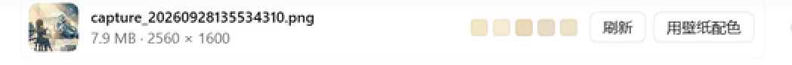

# dsh-desktop-wallpaper

把 **Windows 桌面壁纸**搬进 DeepSeek Harness 的 Web GUI —— 一个 DSH 插件。



输入框下方常驻一条「壁纸条」：左边是当前桌面壁纸的缩略图，中间是文件名、体积和分辨率，
右边是直接从壁纸里提出来的 5 个色卡。点「用壁纸配色」会把整个界面的强调色换成壁纸的主色调，
再点一次「恢复原配色」就还原。

## 它做了什么

| 能力 | 实现 |
| --- | --- |
| 找到当前壁纸 | 先读注册表 `HKCU\Control Panel\Desktop\WallPaper`（用户原始文件），再退回 Windows 自己转码的 `%APPDATA%\Microsoft\Windows\Themes\TranscodedWallpaper`，最后退回 `CachedFiles\` 里最新的一帧 |
| 把壁纸交给浏览器 | Host 半边在 `ctx.webServer` 上注册前缀路由 `/desktop-wallpaper`，`/info` 回元数据 JSON，`/current` 流式回图片字节 |
| 判断图片类型 | 嗅探文件头（PNG / JPEG / BMP / WebP / GIF）。`TranscodedWallpaper` 没有扩展名，内容本身是唯一可靠的判据 |
| 提取调色板 | 浏览器半边把壁纸缩到 48×48 画进 canvas，做 4bit/通道的粗聚类，按「出现得多 + 够鲜艳 + 亮度适中」排序 |
| 变成主题 | 走 `theme.overrideTokens` 叠加一层 `--dsw-alias-brand-primary`，浅色主题压暗、深色主题提亮，不动用户选定的主题本身 |
| 文案 | 走 `ctx.locale`，注册 `zh` / `en` 两份词典 |

## 安装

插件是一个标准的 DSH bundle（`cordis.patch.yml` + Host 半边 + Client 半边），
用当前 profile 的插件管理器装即可：

```
plugin_manager  action: install_bundle
                target: <本仓库目录>
```

安装后 `application` 应为 `applied`，无需重启；`conversation.composer.dock` 槽位里会多出
一个 id 为 `desktop-wallpaper` 的条目。

## 安全说明

壁纸是用户的私人文件，而宿主的 `webServer` 本身不带鉴权和 Origin 校验，
所以本插件自己守这道门（见 `lib/index.js` 的 `isAllowed`）：

1. TCP 对端必须是回环地址 —— 不信可伪造的 Host 头；
2. `sec-fetch-site` 标记 `cross-site` / `same-site` 一律拒绝（同站也是跨端口跨源）；
3. Host 必须是 `localhost` 或 IP 字面量 —— 域名可以重新解析到 127.0.0.1（DNS rebinding），
   只有这一条能拦住；
4. 带 `Origin` 头时必须与 Host 同 host。

非浏览器客户端（Electron IPC 桥、curl）没有 Origin / Fetch Metadata 头，Host 为回环即放行。
代价：以非回环域名（如 `http://mypc.local:port`）访问 DSH 的部署用不了本插件的路由。

## 自检

仓库自带一个不依赖 DSH 运行时的自检脚本，会真的 import 两半代码、真的打一次路由
（因此会读到这台机器上真正的壁纸），并用假的 ctx 检查槽位/词典/主题叠层的接线：

```
node tools/self-check.mjs
```

## 目录

```
dsh-desktop-wallpaper/
├── package.json          # bundle 清单：dsh.bundle.patch + dsh.client
├── cordis.patch.yml      # 把 ui-desktop-wallpaper 这一行插进 profile 名册
├── lib/
│   ├── index.js          # Host 半边：壁纸定位 + 同源受控路由
│   └── client.js         # Client 半边：壁纸条 UI + canvas 提色 + 主题叠层
├── tools/self-check.mjs  # 装机前自检
└── docs/preview-strip.png
```

## 已知限制

- 只支持 Windows：壁纸定位依赖 Windows 注册表与 `%APPDATA%\Microsoft\Windows\Themes`。
- **动态壁纸**（Wallpaper Engine 之类）没有静态图片文件，注册表可能指向一个不存在的路径；
  这时会依次退回 Windows 的转码副本，都取不到就在壁纸条上显示「没有找到桌面壁纸文件」。
- 提取出的主色是一个粗聚类的近似值，不是专业色彩量化；近灰的壁纸会被抬一个饱和度下限，
  否则强调色在界面上看不出来。
- 深色主题下的取值由 `brandTokens` 显式给出（提亮到 l≈0.70），但**尚未在深色主题下实机验证**。
